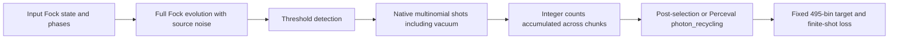

# Optical backend and sampling contract

## Probability flow

The fixed demo input is `[0,0,1,0,1,0,1,0,1,0,0,0]`. One Clements mesh has
66 MZIs with two phases each, giving 132 nominal trainable phase tensors.
Perceval describes the circuit, source noise and detectors; MerLin evaluates
the layer and supplies the Torch multinomial draws.



For four lossless photons in 12 modes, the full fixed-number Fock space has
1,365 outcomes. Only 495 are collision-free. Threshold detection maps two or
more photons in a mode to one click, so fewer than four clicks can also arise
without photon loss. The backend retains the complete detected distribution;
conditioning/mitigation is a later operation. The vacuum counts toward the
initial-shot budget, and empty required sectors fail without extra draws.

Small-circuit controls compare independent permanent/Gram-matrix sums, binomial
loss sectors and HOM coincidences. I=.729 or .84 is supplied directly as the
two-photon overlap input. No extra square root is applied by the caller.
This contract does not validate g2 or a complete hardware noise model.

## Effective shots and the autodiff limitation

The inspected MerLin 0.4.2 training path does not differentiate a loss built
from actual sampled counts through its native sampler. If training mode,
enabled autograd and trainable parameters require a gradient, `shots > 0`
produces a warning and effective shots zero: the output used by backward is
exact. A `shots` argument alone therefore does not establish finite-shot
autodiff training. Sampling under `torch.no_grad()` does use the requested
native draws.

The backend uses `no_grad` for every finite-shot SPSA objective. The custom
optimizer perturbs the phases, obtains two independently evaluated sampled
losses, and updates phases using their SPSA difference estimate. Recycling
uses Perceval's official `photon_recycling()` in that black-box objective,
with no gradient through mitigation. The count adapter below changes aggregation, not this
gradient policy. See [TRAINING.md](TRAINING.md) for the finite-shot training
protocol and shot accounting.

## Stock and vectorized accumulation

`PhotonicBackend.sample()` uses native MerLin sampling in both modes:

- `python`: installed `SamplingProcess.pcvl_sampler` and its Python count loop.
- `vectorized`: a scoped process-local replacement of that private method.
  It keeps each `torch.multinomial` call, replacement policy and row order, and
  replaces only count accumulation with `torch.bincount`.

The adapter is not a new photonic simulator and does not use NumPy draws.
It does temporarily patch a private class method; it is not described as an
entirely unmodified stock implementation. Installed package files are never edited.
An unexpected pre-existing patch or changed sampler signature is rejected.

All project backend sampling holds a reentrant lock over the complete
fork/seed/draw/restore sequence, including every chunk. The lock also protects
the temporary hook. It restores the original method and caller RNG on failure.
This serializes project sampling threads; it is not parallel-shot acceleration.
It cannot coordinate unrelated direct Torch/MerLin calls that ignore the lock.
Do not run those concurrently in the same process, or construct randomly
initialized external layers while this scoped hook is active. Use separate
processes for independent seeds.
Do not mutate a backend's phases or call its raw layer concurrently with sampling.

The validated optimized scope is CPU, float64, one Torch thread, g2=0 and
multinomial sampling. Other devices/precision/g2 do not silently take this path.
Changing the chunk schedule is not claimed to preserve the original random
stream. Count comparisons use the same 1M-by-50 schedule on both sides.

## Fresh validation without private campaign archives

From the workspace root:

```bash
python implementation.py --paper error-qcbm --config configs/sampler_validation_smoke.json
python implementation.py --paper error-qcbm --config configs/sampler_validation_full.json
```

The smoke audit uses a small four-mode/two-photon circuit, 10,000 shots and
short chunks. It is never accepted as production evidence.
The full audit uses the 12-mode/four-photon demo input, 50M shots per call,
1M chunks, and three distinct physical profiles: T=.028/I=.729, T=1/I=.729,
and T=1/I=1. Post-selection and recycling share the same noisy raw-count
comparison, then independently compare their estimated probabilities and KL.

Each profile is compared at an initial phase vector and a fresh phase vector
after **two small ideal SPSA diagnostic updates**. The diagnostic uses 5,000
shots per objective call; it is not the historical 1,000-update trained model.
No private checkpoint, author-code cache, Hub login or financial data is read.
The public audit therefore checks eight condition/phase pairs using six unique
physical count comparisons. Both engines consume 50M shots for each comparison.

The audit records all output-state counts, counts-to-probability/loss equality,
per-chunk RNG-state hashes, caller RNG restoration, source/runtime fingerprints,
wall time and peak process resident memory. It rejects mismatches rather than
substituting a sampler or adding shots. Reports and NPZ counts are runtime outputs.

A complete full audit writes `outdir/sampler_validation/evidence.json`.
Its v2 gate requires all four conditions at both phase points, the full budget
and chunk schedule, matching physical profiles/phases and exact equality.
It pins the Python/platform and installed package versions plus the backend,
adapter and installed MerLin sampler-file hashes. Regenerate evidence on a new
environment; old Linux/PyTorch2.6 evidence is not proof for Windows/PyTorch2.12.
Historical v1 evidence remains supported only when its original strict source,
version and eight-comparison requirements match.

For optional independent-process audits, overlay `sampler_validation.profiles`
with one of `noisy`, `partial`, or `ideal`, set `evidence_file` to null, and run
each via the same shared runtime. Combine complete reports with:

```bash
python error-qcbm/utils/combine_sampler_evidence.py --reports noisy/sampler_equivalence.json partial/sampler_equivalence.json ideal/sampler_equivalence.json --output error-qcbm/outdir/sampler_validation/evidence.json
```

The combination rejects missing/duplicate conditions, incompatible environments
and different diagnostic phases. Independent-process wall times should not be
reported as isolated single-core benchmarks.

## Production selection

The ordinary training configurations keep stock native accumulation by default.
For an explicitly optimized resumable run, set these fields in its JSON config:

```json
{
  "training": {
    "torch_threads": 1,
    "native_chunk_shots": 1000000,
    "native_count_accumulation": "vectorized",
    "vectorized_validation_file": "outdir/sampler_validation/evidence.json"
  }
}
```

These fields are merged into a complete experiment configuration; this fragment
is not a standalone training config. The resumable runner verifies the evidence
before training. Stale source hashes or versions require fresh validation.
Stock execution remains explicit and its throughput differs from the adapter.
Timing claims must name the engine, initial-shot budget, chunk schedule,
precision, thread count and environment. GPU speedups are not claimed here.

## Dependency notices

<details>
<summary>MerLin and Perceval license notices</summary>

### MerLin

```text
MIT License

Copyright (c) 2025 Quandela

Permission is hereby granted, free of charge, to any person obtaining a copy
of this software and associated documentation files (the "Software"), to deal
in the Software without restriction, including without limitation the rights
to use, copy, modify, merge, publish, distribute, sublicense, and/or sell
copies of the Software, and to permit persons to whom the Software is
furnished to do so, subject to the following conditions:

The above copyright notice and this permission notice shall be included in all
copies or substantial portions of the Software.

THE SOFTWARE IS PROVIDED "AS IS", WITHOUT WARRANTY OF ANY KIND, EXPRESS OR
IMPLIED, INCLUDING BUT NOT LIMITED TO THE WARRANTIES OF MERCHANTABILITY,
FITNESS FOR A PARTICULAR PURPOSE AND NONINFRINGEMENT. IN NO EVENT SHALL THE
AUTHORS OR COPYRIGHT HOLDERS BE LIABLE FOR ANY CLAIM, DAMAGES OR OTHER
LIABILITY, WHETHER IN AN ACTION OF CONTRACT, TORT OR OTHERWISE, ARISING FROM,
OUT OF OR IN CONNECTION WITH THE SOFTWARE OR THE USE OR OTHER DEALINGS IN THE
SOFTWARE.
```

### Perceval

```text
MIT License

Copyright (c) 2022 Quandela

Permission is hereby granted, free of charge, to any person obtaining a copy
of this software and associated documentation files (the "Software"), to deal
in the Software without restriction, including without limitation the rights
to use, copy, modify, merge, publish, distribute, sublicense, and/or sell
copies of the Software, and to permit persons to whom the Software is
furnished to do so, subject to the following conditions:

The above copyright notice and this permission notice shall be included in all
copies or substantial portions of the Software.

As a special exception, the copyright holders of exqalibur library give you
permission to combine exqalibur with code included in the standard release of
Perceval under the MIT license (or modified versions of such code). You may
copy and distribute such a combined system following the terms of the MIT
license for both exqalibur and Perceval. This exception for the usage of
exqalibur is limited to the python bindings used by Perceval.

THE SOFTWARE IS PROVIDED "AS IS", WITHOUT WARRANTY OF ANY KIND, EXPRESS OR
IMPLIED, INCLUDING BUT NOT LIMITED TO THE WARRANTIES OF MERCHANTABILITY,
FITNESS FOR A PARTICULAR PURPOSE AND NONINFRINGEMENT. IN NO EVENT SHALL THE
AUTHORS OR COPYRIGHT HOLDERS BE LIABLE FOR ANY CLAIM, DAMAGES OR OTHER
LIABILITY, WHETHER IN AN ACTION OF CONTRACT, TORT OR OTHERWISE, ARISING FROM,
OUT OF OR IN CONNECTION WITH THE SOFTWARE OR THE USE OR OTHER DEALINGS IN THE
SOFTWARE.
```

</details>
