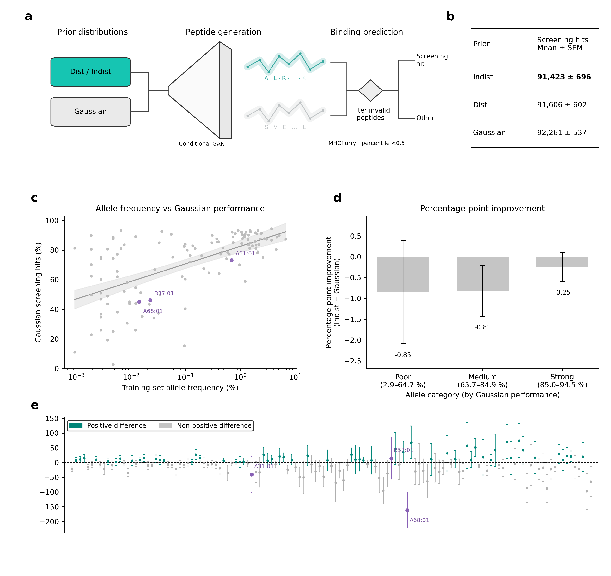
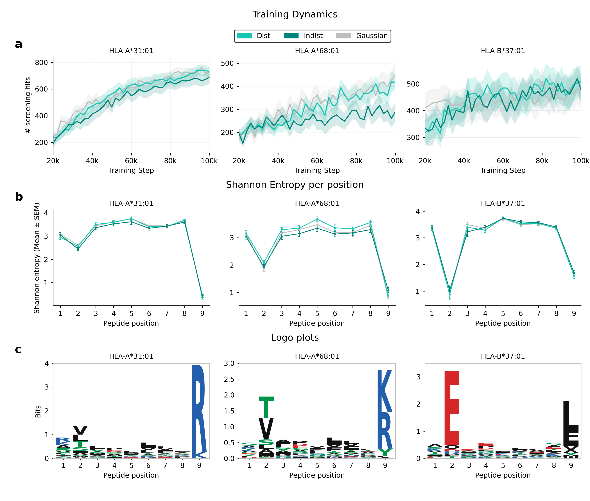
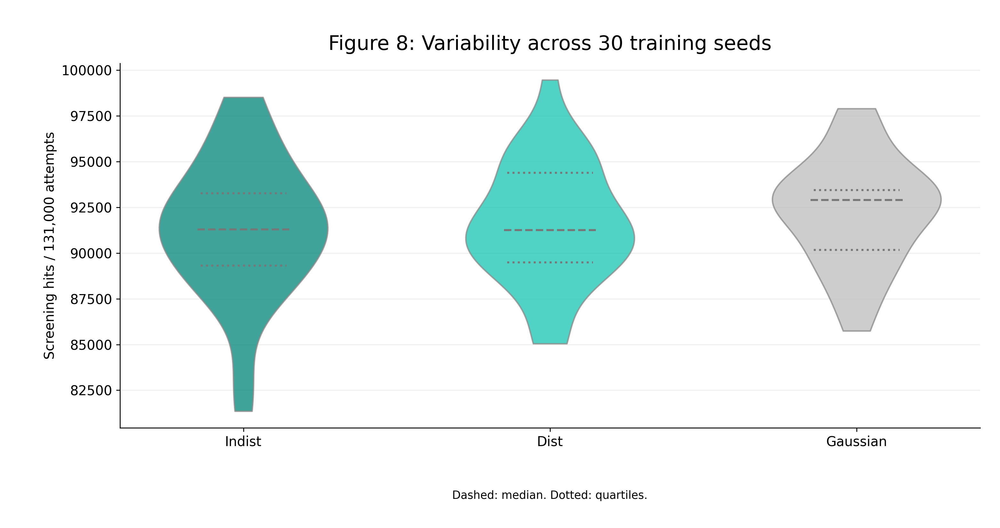
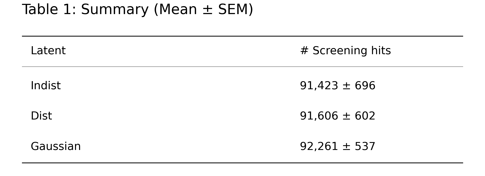

# Fixed-Fock Peptide Generation Results

One fixed MerLin entangling mesh acts on `[1, 0] * 16` across 32 modes. Dist and
Indist share the circuit and input. Gaussian is the reused classical reference.
These are full-model results from archived million-event pools and 100k-update
WGAN-GP checkpoints, separate from the notebook's small learning demonstration.

Evaluation uses MHCflurry 2.3.16 / weights 2.3.0, no flanks and presentation
percentile `<0.5`. Each prior has 30 seeds, 131 HLA and 1,000 attempts per HLA;
invalid attempts remain in the denominator. Error bars summarize seed variability.

## Figure 2 — final performance

Panels show the workflow, final totals, training-set HLA frequency versus Gaussian
performance, grouped Indist-minus-Gaussian differences, and per-HLA differences.
The frequency plot omits five unseen HLA from its log axis; they remain evaluated.
Groups use Gaussian performance (`<65%`, `65–85%`, `>=85%`), not dataset size.
Difference bars use paired-seed SEM. The frequency regression is descriptive,
with a 95% mean confidence band; it does not isolate a causal scarcity effect.

## Figure 3 — learning curves, entropy and motifs

The cases are A31:01, A68:01 and B37:01. Curves contain 41 measured checkpoints
from 20k to 100k updates and use seed SEM shading. Final endpoints match the final
totals. Positional entropy is among screened canonical 9-mers, including duplicates.
One Gaussian A68:01 seed has an empty population and undefined entropy; its mean
uses 29 seeds. Indist logos use pooled counts relative to a uniform 20-amino-acid
background. These examples do not establish behavior across all HLA.

## Figure 8 and Table 1 — seed variability

Each violin contains 30 totals out of 131,000 attempts. Dashed lines are medians;
dotted lines are quartiles. Table values are mean ± seed SEM. Gaussian has the
highest mean in this setting; mean rankings do not prove equivalence or general
quantum advantage. 

## Included files

Only final PNG images and editable SVGs are distributed here. Underlying experiment
CSVs, sampled pools, trained models, generated-sequence lists and prediction files
are not included. The notebook samples events, trains its demonstration models
and generates peptides on each run. The separate full-experiment figures are
available above and from the project README.
